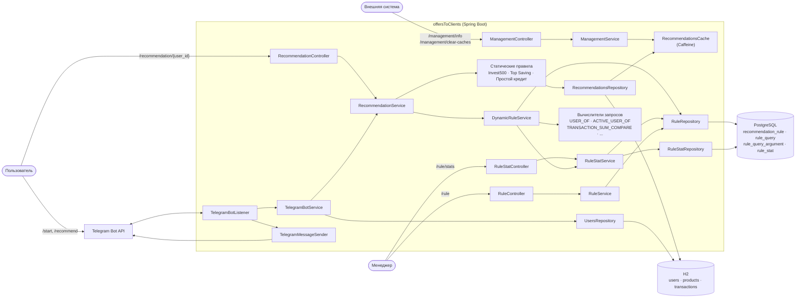
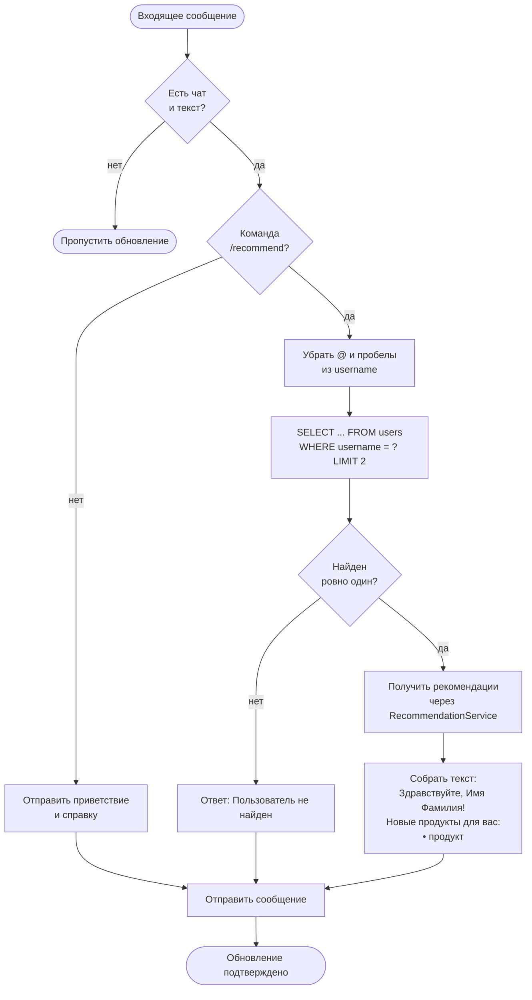

# Архитектура

Приложение — монолит на Spring Boot с чётким разделением на слои: контроллеры, сервисы,
репозитории и две независимые базы данных.

## Компоненты и внешние системы



### Внешние вызовы

| Источник | Направление | Что вызывает |
|---|---|---|
| Менеджер | в приложение | `POST /rule`, `GET /rule`, `DELETE /rule/{id}`, `GET /rule/stats` |
| Пользователь | в приложение | `GET /recommendation/{user_id}` |
| Пользователь | в Telegram → приложение | `/start`, `/recommend <username>` (long polling) |
| Внешняя система | в приложение | `GET /management/info`, `POST /management/clear-caches` |
| Приложение | в Telegram Bot API | `getUpdates`, `sendMessage` |
| Приложение | в PostgreSQL | чтение и запись динамических правил и статистики |
| Приложение | в H2 (файл) | чтение клиентов, продуктов и транзакций (read-only) |

### Взаимодействие компонентов

**Рекомендации.** `RecommendationController` вызывает `RecommendationService`, который сначала
обходит все найденные Spring бины `RecommendationRuleSet` (статические правила BR-01…BR-03),
затем вызывает `DynamicRuleService`. Тот загружает правила из PostgreSQL через `RuleRepository`,
подбирает для каждого запроса вычислитель `QueryEvaluator` по `QueryType` и при совпадении всех
запросов инкрементирует статистику через `RuleStatService`. Результаты объединяются в
`LinkedHashMap` по `productId`, поэтому дубли отбрасываются, а статические продукты имеют приоритет.

**Данные.** Два источника данных настраиваются раздельно: `defaultDataSource` (PostgreSQL)
используется JPA и Liquibase, `recommendationsJdbcTemplate` (H2, read-only) — только для SELECT-ов
по клиентским данным. Агрегаты H2 проходят через `RecommendationsRepository` и кэш `Caffeine`.

**Статистика.** `RuleStatRepository.increment` выполняет нативный upsert, поэтому счётчик растёт
без гонок. `RuleStatService.getStats` склеивает список всех `id` правил с найденными счётчиками:
отсутствующая строка трактуется как `0`.

**Telegram.** `TelegramBotListener` регистрируется как `UpdatesListener`, если бин `TelegramBot`
создан (то есть задан токен). Разбор команд выполняет `TelegramBotService`, отправку —
`TelegramMessageSender`. Ошибки отправки и опроса логируются и не влияют на REST API.

**Управление.** `ManagementController` отдаёт данные сборки (`BuildProperties`, с запасным
значением `unknown`) и вызывает `ManagementService.clearCaches`, который очищает три кэша Caffeine.

## Диаграмма деятельности: алгоритм выдачи рекомендаций

```mermaid
flowchart TD
    start([GET /recommendation/{user_id}]) --> staticRules[Проверить статические правила]
    staticRules --> br01{"BR-01 Invest500:<br/>есть дебет, нет инвестиций,<br/>пополнения накоплений > 1000?"}
    br01 -- да --> add01[Добавить Invest500]
    br01 -- нет --> br02
    add01 --> br02{"BR-02 Top Saving:<br/>есть дебет, пополнения ≥ 50 000,<br/>депозит > снятий?"}
    br02 -- да --> add02[Добавить Top Saving]
    br02 -- нет --> br03
    add02 --> br03{"BR-03 Простой кредит:<br/>нет кредита, снятия > 100 000,<br/>депозит > снятий?"}
    br03 -- да --> add03[Добавить Простой кредит]
    br03 -- нет --> loadRules
    add03 --> loadRules[Загрузить динамические правила<br/>из PostgreSQL]
    loadRules --> hasRule{"Остались<br/>правила?"}
    hasRule -- да --> allQueries{"Все запросы<br/>правила истинны?"}
    allQueries -- да --> inc["Увеличить hit_count<br/>(INSERT ... ON CONFLICT)"]
    inc --> addProduct[Добавить продукт правила]
    addProduct --> hasRule
    allQueries -- нет --> skip[Пропустить правило]
    skip --> hasRule
    hasRule -- нет --> dedup[Убрать дубли по product_id<br/>статический продукт приоритетнее]
    dedup --> end([Вернуть список рекомендаций])
```

### Алгоритм по шагам

1. Выполняются три статических правила из первого ТЗ, каждое обращается к H2 только за
   агрегатами (количество операций и суммы), которые кэшируются Caffeine.
2. Загружаются все динамические правила вместе с запросами и аргументами
   (`@EntityGraph`, один запрос к PostgreSQL).
3. Правило считается сработавшим, если непустой список запросов даёт `true` для всех элементов;
   результат каждого запроса может инвертироваться флагом `negate`.
4. За каждое срабатывание правило получает `+1` в статистике.
5. Список продуктов дедуплицируется по `product_id`; при конфликте остаётся статический продукт.

## Диаграмма деятельности: обработка команды Telegram



## Ключевые проектные решения

| Решение | Причина |
|---|---|
| Две базы данных с раздельными `DataSource` | клиентские данные H2 только читаются, правила и статистика живут в PostgreSQL и меняются приложением |
| H2 открывается в `readOnly` режиме | исключает случайную запись в клиентские данные |
| Кэш вынесен в `RecommendationsCache` | репозиторий сохраняет ровно три публичных метода, а кэшем можно управлять снаружи |
| Статистика через нативный upsert | атомарность без блокировок и без потери инкрементов |
| Нативные SQL-запросы для агрегатов | прозрачны, легко индексируются и не требуют JPA-сущностей для клиентских таблиц |
| Необязательный бин `TelegramBot` | приложение и тесты работают без токена |
| Отдельный `UsersRepository` | не раздувает `RecommendationsRepository` и держит поиск по username в одном месте |
