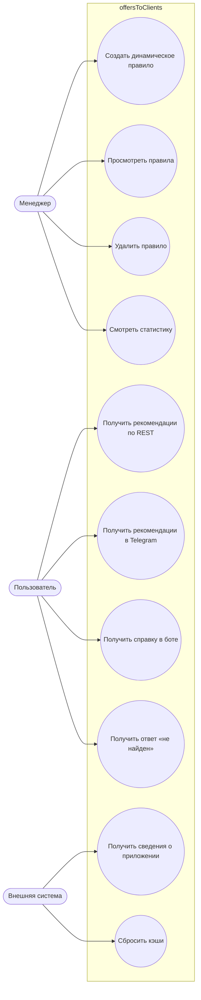

# Требования

Документ фиксирует функциональные и нефункциональные требования к сервису `offersToClients`.
Каждое требование имеет уникальный идентификатор: `US-*` — user story, `NFR-*` —
нефункциональное требование, `BR-*` — бизнес-правило.

## Акторы

| Актор | Описание | Канал взаимодействия |
|---|---|---|
| Менеджер | сотрудник банка, который настраивает динамические правила и следит за их эффективностью | REST API |
| Пользователь | клиент банка, которому нужны персональные предложения | REST API, Telegram-бот |
| Внешняя система | служебный потребитель: мониторинг, оркестратор, система эксплуатации | REST API (`/management`) |

## Функциональные требования (User Stories)

### US-01 — Создание динамического правила

**Как** менеджер, **я хочу** создавать динамическое правило рекомендации, **чтобы** предлагать
клиентам новые продукты без изменения кода и повторного развёртывания.

Критерии приёмки:

- `POST /rule` принимает `product_name`, `product_id`, `product_text` и непустой список `rule`;
- каждый запрос правила содержит допустимый `query`, корректное число аргументов и `negate`;
- при успехе возвращается `200` и сохранённое правило с `id`;
- при некорректных данных возвращается `400` и тело `{"error": "..."}`;
- правило сохраняется в PostgreSQL в таблицах `recommendation_rule`, `rule_query`,
  `rule_query_argument`.

### US-02 — Просмотр списка правил

**Как** менеджер, **я хочу** получать список всех динамических правил, **чтобы** понимать,
какие продукты сейчас настраиваются через API.

Критерии приёмки:

- `GET /rule` возвращает `{"data": [...]}`;
- у каждого правила есть `id`, `product_name`, `product_id`, `product_text` и `rule`;
- порядок запросов внутри правила сохраняется.

### US-03 — Удаление правила

**Как** менеджер, **я хочу** удалять динамическое правило, **чтобы** прекратить показ продукта,
который больше не актуален.

Критерии приёмки:

- `DELETE /rule/{id}` возвращает `204` при успехе и `404`, если правила нет;
- вместе с правилом удаляются его запросы и статистика (каскад на уровне БД);
- удалённое правило исчезает из `GET /rule` и `GET /rule/stats`.

### US-04 — Статистика срабатываний

**Как** менеджер, **я хочу** видеть, сколько раз сработало каждое правило, **чтобы** оценивать
эффективность настроенных предложений.

Критерии приёмки:

- `GET /rule/stats` возвращает `{"stats": [{"rule_id": 1, "count": 2}, ...]}`;
- в ответе присутствуют **все** правила, включая те, у которых `count = 0`;
- счётчик увеличивается ровно на единицу за каждое срабатывание;
- инкремент атомарный: параллельные запросы не теряют срабатывания;
- статистика удаляется вместе с правилом.

### US-05 — Рекомендации через REST API

**Как** пользователь, **я хочу** получать список рекомендованных продуктов по моему `user_id`,
**чтобы** видеть персональные предложения в мобильном приложении и интернет-банке.

Критерии приёмки:

- `GET /recommendation/{user_id}` возвращает `200` и `{"user_id": "...", "recommendations": [...]}`;
- учитываются и статические правила (BR-01…BR-03), и динамические правила из БД;
- продукты не дублируются: при совпадении `id` остаётся первый найденный;
- каждый продукт содержит `name`, `id`, `text`;
- пустой список возвращается как `"recommendations": []`, а не `null`.

### US-06 — Рекомендации в Telegram

**Как** пользователь, **я хочу** получить рекомендации командой `/recommend <username>`,
**чтобы** не открывать приложение банка.

Критерии приёмки:

- бот отвечает приветствием `Здравствуйте, <Имя Фамилия>!`;
- далее идёт секция `Новые продукты для вас:` и список продуктов, каждый с новой строки с маркером `•`;
- username ищется без учёта ведущего `@`;
- приветствие и список формируются на основе тех же правил, что и REST API;
- срабатывания динамических правил через бота попадают в статистику.

### US-07 — Справка в Telegram

**Как** пользователь, **я хочу** получать справку по команде `/start`, **чтобы** понять,
как пользоваться ботом.

Критерии приёмки:

- на `/start` и любую неизвестную команду бот отвечает приветствием и списком команд;
- в справке указан синтаксис `/recommend <username>` и пример.

### US-08 — Пользователь не найден

**Как** пользователь, **я хочу** получать понятный ответ, если логин указан неверно, **чтобы**
не думать, что бот сломался.

Критерии приёмки:

- если найдено ноль клиентов с таким `username` — ответ ровно `Пользователь не найден`;
- если найдено больше одного клиента — тот же ответ;
- регистр и пробелы вокруг логина не приводят к ложному «не найден» (логин обрезается).

### US-09 — Информация о приложении

**Как** внешняя система, **я хочу** получать название и версию приложения, **чтобы** вести
инвентаризацию развёрнутых сервисов.

Критерии приёмки:

- `GET /management/info` возвращает `{"name": "...", "version": "..."}`;
- значения берутся из `pom.xml` (`artifactId` и `version`) через `build-info`;
- при запуске без build-info возвращается версия `unknown`.

### US-10 — Сброс кэшей

**Как** внешняя система, **я хочу** сбрасывать кэши рекомендаций, **чтобы** после обновления
клиентских данных пользователи сразу видели актуальные предложения.

Критерии приёмки:

- `POST /management/clear-caches` принимает запрос без тела и возвращает `204`;
- после вызова следующий запрос рекомендаций снова читает данные из H2;
- содержимое ответа API не меняется, меняется только источник данных.

## Бизнес-правила (статические правила первого ТЗ)

| ID | Продукт | Условие срабатывания | Реализация |
|---|---|---|---|
| BR-01 | Invest500 | есть хотя бы одна дебетовая транзакция; нет инвестиций; сумма пополнений накопительного счёта > 1000 | `Invest500RuleSet` |
| BR-02 | Top Saving | есть дебетовый счёт; сумма пополнений дебета или накопительного счёта ≥ 50 000; пополнения дебета превышают снятия | `TopSavingRuleSet` |
| BR-03 | Простой кредит | нет кредитных продуктов; сумма снятий по дебету > 100 000; пополнения дебета превышают снятия | `SimpleCreditRuleSet` |

Статические правила намеренно реализованы в коде: первое ТЗ фиксирует их как часть бизнес-логики.
Динамические правила добавляются поверх и не могут их отменить.

## Нефункциональные требования

### NFR-01 — Производительность чтения агрегатов

Агрегатные запросы к H2 (количество и суммы транзакций) кэшируются в Caffeine с максимальным
размером 10 000 записей на кэш. Повторный запрос рекомендаций для того же клиента не обращается
к базе; целевое время ответа `GET /recommendation/{user_id}` при прогретом кэше — не более 200 мс.

### NFR-02 — Согласованность статистики

Инкремент счётчика выполняется одним SQL-оператором
`INSERT ... ON CONFLICT (rule_id) DO UPDATE SET hit_count = hit_count + 1`.
Потеря срабатываний при параллельных запросах недопустима; уникальность обеспечивается
ограничением `UNIQUE (rule_id)`.

### NFR-03 — Отказоустойчивость интеграции с Telegram

Отсутствие токена или недоступность Telegram не должны мешать запуску приложения и работе REST API.
Ошибки long polling логируются и не завершают процесс.

### NFR-04 — Логирование ошибок

Ошибки отправки сообщений и ошибки опроса Telegram логируются через SLF4J с указанием чата и причины.
Внутренние исключения не попадают в тело HTTP-ответа: клиент получает сообщение из `ErrorResponse`.

### NFR-05 — Персистентность и миграции

Схема PostgreSQL управляется Liquibase (`db/changelog`), Hibernate работает в режиме
`ddl-auto=validate`. Ручные изменения схемы в обход миграций не допускаются.

### NFR-06 — Безопасность конфигурации

Секреты (токен бота, пароли БД) передаются только через переменные среды и не хранятся в репозитории.
В `application.properties` остаются только комментарии-примеры.

### NFR-07 — Документированность API

Все публичные эндпоинты описаны в OpenAPI 3.0 (`docs/api/openapi.yaml`) с методами, путями,
схемами запросов и ответов и кодами ошибок.

### NFR-08 — Читаемость и сопровождаемость кода

Код отформатирован стандартными средствами IntelliJ IDEA, публичные классы и методы имеют Javadoc,
сложные места (upsert статистики, сборка вычислителей, прокси для Telegram) прокомментированы.
За-комментированного кода в проекте нет.

## Диаграмма вариантов использования

Связь требований с кодом и задачами: [Трассировка](Traceability).
